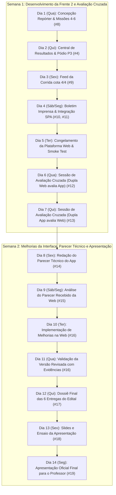

# Planejamento do Trabalho Final (2 Semanas) — Scrum / Kanban
**Projeto:** Plataforma Digital para Campeonato de Corrida de Carros por Controle Remoto (RC)  
**Curso:** Engenharia de Computação – Instituto Federal do Ceará (IFCE Fortaleza)  
**Disciplina:** Interação Humano-Computador (IHC) – Semestre 2026.2  
**Dupla Web:** Matheus de Sousa Almeida (Frente 1) & Vinícius Silva Pereira (Frente 2)  
**Dupla Parceira de Avaliação Cruzada (App):** Dupla Mobile (Piloto e Espectador)  
**Horizonte Temporal:** 2 Semanas (14 dias corridos / 10 dias úteis de trabalho ágil)  

---

## 1. Visão Geral Metodológica (Scrum & Kanban no GitHub)

O projeto é conduzido sob a metodologia ágil **Scrum-Kanban (Scrumban)**, utilizando o **GitHub Projects** integrado às *Issues* e *Pull Requests* do repositório para assegurar rastreabilidade total entre os requisitos do Edital de IHC e as implementações de código e documentação.

```
+----------------------------------------------------------------------------------------------------+
|                                FLUXO KANBAN GITHUB PROJECTS                                       |
+-------------------+-------------------+-------------------+-------------------+--------------------+
| 📋 PRODUCT BACKLOG | 📌 SPRINT BACKLOG | ⚙️ IN PROGRESS    | 🔍 REVIEW / QA    | ✅ DONE            |
| Requisitos Edital | Semana corrente   | Tarefa em ação    | Testes, Code Rev. | Merge & Aprovado   |
| (Priorizados)     | (Matheus/Vinícius)| (WIP Limit: 1/dev)| e Avaliação Cruz. | (Gabarito 100%)    |
+-------------------+-------------------+-------------------+-------------------+--------------------+
```

### 1.1 Divisão das Duas Semanas de Sprint
*   **Sprint 1 (Semana 1 — Dias 1 a 7):** Conclusão e integração do sistema Web (Frente 1 finalizada, Frente 2 concluída), congelamento da versão avaliativa e **execução da Avaliação Cruzada** com a Dupla App (execução das 6 missões de usabilidade).
*   **Sprint 2 (Semana 2 — Dias 8 a 14):** Análise dos relatórios de avaliação, **Ciclo de Melhorias da Interface Web** (pós-parecer), consolidação do **Parecer Técnico da Dupla App**, fechamento do dossiê com as 6 entregas e ensaio da **Apresentação Final**.

### 1.2 Papéis e Frentes da Dupla Web
*   **Matheus de Sousa Almeida (Frente 1):** Fundação SPA, Motor Determinístico, Shell/Temas, Dashboard Estratégico, Comparativo de Pilotos, Baterias/Pit Stop, Persona 1 (Técnico Beto Almeida), Missões 1 a 3.
*   **Vinícius Silva Pereira (Frente 2):** Central de Resultados, Classificação Geral com histórico, Feed com trava preventiva 4/4, Estúdio de Boletim de Imprensa, Persona 2 (Repórter Camila Rocha), Missões 4 a 6.
*   **Atividades Conjuntas:** Avaliação cruzada do App mobile, elaboração do Parecer Técnico, ciclo de melhorias e apresentação final ao professor.

---

## 2. Quadro Scrum / Kanban no GitHub Projects

Abaixo está o estado vivo do quadro Kanban, separando com precisão **o que já foi realizado (Done)** e **o que falta fazer (In Progress, Sprint Backlog e Product Backlog)**.

### 2.1 Coluna: ✅ DONE (Concluído e Validado)

| ID / Issue | Título da Tarefa | Resp. | Entregável / Edital | Evidências / Commits |
| :--- | :--- | :---: | :--- | :--- |
| **#1** | **PRD & Arquitetura Base da Plataforma Web** | Dupla | Seção 1, 4.1, 4.2 | ADR-0001, GLOSSARY.md, CONTEXT.md |
| **#2** | **Fundação da SPA, Motor Determinístico e Shell de Navegação** | Matheus | Seção 4.1, 4.2, 5.2 | Commit `efcff41`, `ChampionshipStore.ts`, StorageAdapter, atalhos de teclado (`1-5`, `?`, `Espaço`), temas claro/escuro |
| **#5** | **Documento de Concepção (Parte 1: Técnico Beto) e Missões 1 a 3** | Matheus | Seção 3, 5.2, 5.3, 6.1 | Commit `fe8fc58`, `documento_de_concepcao.md`, `missoes_de_usabilidade.md`, 5 testes Node.js verdes |
| **#3** | **Dashboard Estratégico, Comparativo Pareado e Baterias** | Matheus | Seção 4.1, 4.4, 5.2 | Commit `efb885c`, `DashboardView.tsx`, telemetria com deltas, seletor de ritmo e simulação ao vivo Prova 4 |
| **#6** | **Suíte de Testes Automatizados da Frente 1 & Validação TDD** | Matheus | Critério Geral | 28 testes automatizados cobrindo pontuação 10-6-3-2-1-0, soma por equipe e integridade |

---

### 2.2 Coluna: ⚙️ IN PROGRESS (Em Andamento Neste Momento)

| ID / Issue | Título da Tarefa | Resp. | Estimativa | Critério de Aceite / IHC |
| :--- | :--- | :---: | :---: | :--- |
| **#8** | **Documento de Concepção (Parte 2: Repórter Camila) e Missões 4 a 6** | Vinícius | 1 dia | Formalizar Persona 2, cenário pós-corrida da Prova 3 e gabaritos determinísticos das Missões 4, 5 e 6 em `missoes_de_usabilidade.md`. |
| **#4** | **Central de Resultados, Classificação Geral e Pódio da Prova 3** | Vinícius | 1.5 dias | Exibir pódio destacado (1º a 3º), volta mais rápida e classificação acumulada com filtro de evolução histórica. |

---

### 2.3 Coluna: 📌 SPRINT 1 BACKLOG (To Do — Semana 1)

| ID / Issue | Título da Tarefa | Resp. | Prazo | Critério de Aceite / IHC |
| :--- | :--- | :---: | :---: | :--- |
| **#9** | **Feed da Corrida com Cota Rigorosa 4/4 e Bloqueio Preventivo** | Vinícius | Dia 3 | Filtro por equipe e categoria; contador visual `X/4`; bloqueio preventivo de 5ª postagem com mensagem clara (Bastien & Scapin: Gestão de Erros). |
| **#10** | **Estúdio de Boletim de Imprensa em 1 Clique** | Vinícius | Dia 4 | Construtor rápido de matéria pós-prova com resumo do pódio e declarações do feed; botão de cópia instantânea em menos de 10 minutos (Nielsen #7). |
| **#11** | **Integração Global da SPA, Code Review e Congelamento de Versão** | Dupla | Dia 4-5 | Merge de `feat/matheus` e `feat/vinicius`; validação de todos os fluxos das 6 missões e deploy/congelamento determinístico. |
| **#12** | **Execução da Avaliação Cruzada no App da Dupla Oposta** | Dupla | Dia 6-7 | Executar as 6 missões no App móvel; cronometrar tempos, registrar hesitações, desvios e evidências visuais (Edital Seção 6.2). |
| **#13** | **Acompanhamento da Execução das Nossas 6 Missões pela Dupla App** | Dupla | Dia 6-7 | Observar sem interferir os avaliadores executando as Missões 1 a 6 na plataforma Web; recolher dúvidas e dados de usabilidade. |

---

### 2.4 Coluna: 📋 SPRINT 2 BACKLOG (To Do — Semana 2)

| ID / Issue | Título da Tarefa | Resp. | Prazo | Critério de Aceite / IHC |
| :--- | :--- | :---: | :---: | :--- |
| **#14** | **Elaboração e Emissão do Parecer Técnico da Interface do App** | Dupla (Vinícius lead) | Dia 8-9 | Preenchimento da tabela de avaliação e parecer estruturado fundamentado em Bastien & Scapin e Nielsen (Edital Seção 7). |
| **#15** | **Triagem do Parecer Recebido da Dupla App sobre a Plataforma Web** | Dupla (Matheus lead) | Dia 9 | Análise crítica dos apontamentos recebidos; priorização em matriz Esforço x Impacto; definição das melhorias a implementar. |
| **#16** | **Ciclo de Melhorias da Interface Web (Versão Revisada pós-teste)** | Dupla | Dia 10-11 | Implementar melhorias de ergonomia identificadas no teste; documentar justificativa para itens não adotados (Edital Seção 8). |
| **#17** | **Consolidação do Dossiê Final de Documentação (Entregas 1 a 5)** | Dupla | Dia 12 | Unificar Documento de Concepção, Missões, Relatório de Avaliação Cruzada e Evidências das Melhorias em PDF oficial. |
| **#18** | **Criação dos Slides e Roteiro de Apresentação Final** | Dupla | Dia 13 | Slides demonstrando o problema real, personas, fundamentação ergonômica, demo ao vivo e lições aprendidas (Edital Seção 9.6). |
| **#19** | **Ensaio Geral em Dupla e Apresentação para o Professor** | Dupla | Dia 14 | Simulação cronometrada da apresentação em banca, validação de áudio/vídeo e passagem de bastão entre os integrantes. |

---

### 2.5 Coluna: 🔍 REVIEW & QUALITY ASSURANCE (Critérios de Qualidade Contínua)
*   **Gate 1 (Build & Tipos):** `tsc --noEmit` sem warnings e build de produção Vite gerado sem quebra.
*   **Gate 2 (Testes de Regressão):** Suíte Vitest de testes de regras de pontuação (`10-6-3-2-1-0`), persistência desacoplada e integridade textual das missões 100% verde.
*   **Gate 3 (Gabarito Determinístico):** Dados da Prova 1 a 4 conferem exatamente com os números previstos nos testes de avaliação cruzada.
*   **Gate 4 (Acessibilidade & Dupla Codificação):** Nenhuma informação crítica veiculada unicamente por cor (combinação obrigatória de cor + ícone + rótulo textual legível).

---

## 3. Cronograma Executivo de 2 Semanas (Dia a Dia)



### Detalhamento Cronológico das Atividades

#### SEMANA 1 — Sprint 1: Finalização da Frente 2, Integração e Avaliação Cruzada
*   **Dia 1 (11/11/2026 - Quarta-feira):**
    *   *Matheus:* Alinhamento de arquitetura, revisão dos contratos do `ChampionshipStore` e apoio na modelagem da Frente 2.
    *   *Vinícius:* Elaboração formal da Persona Camila Rocha (Repórter) e redação das Missões de Usabilidade 4, 5 e 6 em `docs/missoes_de_usabilidade.md` (Issue #8).
    *   *Milestone do Dia:* Documento de concepção e missões 100% formalizadas.
*   **Dia 2 (12/11/2026 - Quinta-feira):**
    *   *Vinícius:* Implementação da `ResultsView` com visualização do pódio, melhor volta da prova, detalhe da volta 20 da Prova 3 e tabela de classificação geral com a regra oficial `10-6-3-2-1-0` (Issue #4).
    *   *Matheus:* Implementação dos filtros de evolução histórica da classificação e suporte a critérios de desempate no store.
*   **Dia 3 (13/11/2026 - Sexta-feira):**
    *   *Vinícius:* Implementação da `FeedView` com limite estrito de 4 publicações por equipe por prova, badge visual de cota `X/4`, filtros por escuderia e bloqueio preventivo de overflow (Issue #9).
    *   *Matheus:* Validação ergonômica de mensagens de erro preventivas e atalhos rápidos.
*   **Dia 4 (14/11/2026 a 16/11/2026 - Fim de Semana / Segunda-feira):**
    *   *Vinícius:* Implementação do Estúdio de Boletim de Imprensa pós-prova com gerador de texto e cópia para área de transferência em 1 clique (Issue #10).
    *   *Matheus & Vinícius:* Integração dos branches em `main`/`feat/matheus`, revisão cruzada de código e validação dos 28+ testes automatizados (Issue #11).
*   **Dia 5 (17/11/2026 - Terça-feira):**
    *   *Dupla Web:* Congelamento da versão da aplicação Web (*Release Candidate 1*), teste de fumaça das 6 missões e entrega do link/repositório e roteiro de teste para a Dupla App.
    *   *Milestone do Dia:* Plataforma Web pronta e congelada para avaliação de terceiros.
*   **Dia 6 (18/11/2026 - Quarta-feira):**
    *   *Dupla Web:* Realização da **Avaliação Cruzada no aplicativo móvel da Dupla App**. Matheus e Vinícius executam as 6 missões propostas pela dupla oposta, gravando telas, cronometrando tempo e registrando dificuldades (Issue #12).
*   **Dia 7 (19/11/2026 - Quinta-feira):**
    *   *Dupla Web:* Acompanhamento da sessão onde a Dupla App executa as Missões 1 a 6 na nossa plataforma Web (como observadores passivos, sem fornecer instruções de caminho, conforme Seção 6.2 do Edital) (Issue #13).

---

#### SEMANA 2 — Sprint 2: Parecer Técnico, Ciclo de Melhorias e Apresentação
*   **Dia 8 (20/11/2026 - Sexta-feira):**
    *   *Vinícius (Lead) & Matheus:* Redação técnica do **Parecer de Usabilidade do App** da dupla oposta, catalogando os problemas segundo o modelo da Seção 7.1 do Edital, com fundamentação rigorosa em Bastien & Scapin e Heurísticas de Nielsen (Issue #14).
*   **Dia 9 (21/11/2026 a 23/11/2026 - Fim de Semana / Segunda-feira):**
    *   *Dupla Web:* Recebimento do parecer técnico emitido pela Dupla App sobre a nossa plataforma Web. Reunião de triagem para classificar os feedbacks, definir a viabilidade e planejar as correções (Issue #15).
*   **Dia 10 (24/11/2026 - Terça-feira):**
    *   *Matheus & Vinícius:* Implementação das melhorias aprovadas na interface Web (ajustes de rotulagem, refinamentos no tema Pit Lane, clareza no feed, etc.) criando a **Versão Revisada da Interface** (Issue #16).
*   **Dia 11 (25/11/2026 - Quarta-feira):**
    *   *Dupla Web:* Elaboração da documentação de melhorias: registro de telas antes x depois, justificativa formal das melhorias aceitas e justificativa fundamentada em IHC dos itens eventualmente não adotados (Seção 8 do Edital).
*   **Dia 12 (26/11/2026 - Quinta-feira):**
    *   *Dupla Web:* Montagem e consolidação do **Dossiê Final das Entregas** (reunindo Documento de Concepção, Guia das 6 Missões, Parecer do App, Relatório de Melhorias da Web) (Issue #17).
*   **Dia 13 (27/11/2026 - Sexta-feira):**
    *   *Dupla Web:* Elaboração dos slides para a apresentação final (problema, personas, fundamentação ergonômica, demonstração prática e lições da avaliação cruzada) e ensaio geral cronometrado (Issue #18).
*   **Dia 14 (30/11/2026 - Segunda-feira):**
    *   *Dupla Web:* **Apresentação Final para o Professor** e entrega oficial de todos os artefatos no prazo (Issue #19).

---

## 4. Mapeamento com as 6 Entregas do Edital

O cronograma garante cobertura de 100% dos requisitos de avaliação do Edital:

| # | Entrega Oficial do Edital (Seção 9) | Peso | Status no Scrum Kanban | Responsável |
| :-: | :--- | :-: | :--- | :--- |
| **1** | **Documento de Concepção:** Personas, cenários de uso, catálogo de pilotos/equipes e detalhamento de funcionalidades com fundamentação IHC | 15% | 70% Concluído (Parte 1 pronta em `#5`; Parte 2 em andamento em `#8`) | Matheus (P1) & Vinícius (P2) |
| **2** | **Protótipo Navegável ou Sistema:** Interface Web funcional com as regras do campeonato (10-6-3-2-1-0, soma de duplas, Prova 4 ao vivo, cota 4/4) | 20% | 75% Concluído (Frente 1 100% pronta em `#2` e `#3`; Frente 2 em `#4`, `#9` e `#10`) | Dupla Web |
| **3** | **Documento das Seis Missões:** Apresentação por objetivos e gabaritos determinísticos de sucesso sem induzir controles de navegação | 20% | 50% Concluído (Missões 1 a 3 prontas em `#5`; Missões 4 a 6 em `#8`) | Matheus (M1-3) & Vinícius (M4-6) |
| **4** | **Relatório de Avaliação da Dupla Oposta:** Execução das 6 missões no App e emissão de Parecer Técnico fundamentado em Bastien & Scapin e Nielsen | 15% | Planejado para a Semana 1/2 (`#12`, `#14`) | Dupla Web (Vinícius Lead) |
| **5** | **Versão Revisada da Interface:** Alterações realizadas após o parecer da dupla oposta, com justificativas e evidências de melhorias | 10% | Planejado para a Semana 2 (`#15`, `#16`) | Dupla Web (Matheus Lead) |
| **6** | **Apresentação Final:** Demonstração ao vivo do sistema para o professor, decisões de design, problemas encontrados e melhorias | 20%* | Planejado para os Dias 13 e 14 (`#18`, `#19`) | Matheus & Vinícius |

*\*Nota: No edital, a apresentação e melhorias somam 10% diretos de critério, somados à aplicação dos conceitos ergonômicos e fluxos que são demonstrados na banca.*

---

## 5. Como Apresentar Este Cronograma para o Professor

Ao apresentar esta proposta de cronograma de 2 semanas para o professor na reunião de acompanhamento, destaque os seguintes pontos fortes da equipe:

1.  **Forte maturidade de engenharia de software e IHC:** O trabalho não começou do zero; a base arquitetural mais desafiadora (o motor determinístico de estado com histórico de *Undo*, tema de alto contraste para pit lane e o dashboard com dupla codificação semântica) já está implementada e testada com 28 testes automatizados.
2.  **Adesão estrita ao Edital e Métricas de Usabilidade:** Todas as tarefas do Kanban estão atreladas aos itens formais do edital (Seções 3, 4, 5, 6, 7, 8 e 9).
3.  **Planejamento realista para a Avaliação Cruzada:** A alocação da virada da Semana 1 para a Semana 2 reserva tempo suficiente para executar o teste com a Dupla App sem correria, permitindo um Parecer Técnico aprofundado e um ciclo real de melhorias na interface.
4.  **Transparência e Controle pelo GitHub Projects:** O professor pode auditar em tempo real os commits, PRs e o avanço dos cartões no quadro do repositório.
